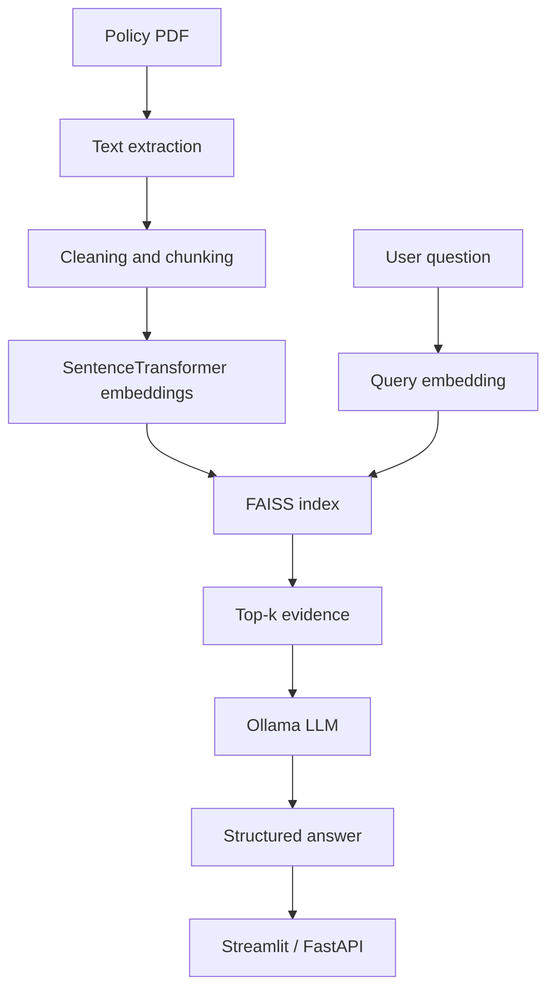

# Insurance RAG System: Enterprise Document Q&A Automation

> AI-powered question answering over insurance policy documents using retrieval-augmented generation (RAG).


**Insurance RAG System: Enterprise Document Q&A Automation** is a portfolio project exploring natural-language question answering over insurance policy documents. The original prototype combines PDF extraction, SentenceTransformers embeddings, FAISS retrieval, Ollama inference, Streamlit, and FastAPI.

**Disclaimer:** This is an experimental portfolio project, not an insurance decision engine. Outputs may be incomplete or incorrect and must not be used to approve or deny claims or replace professional advice.

## Intended workflow

1. Accept an insurance policy PDF or document URL.
2. Extract text and split it into passages.
3. Generate embeddings and retrieve relevant passages with FAISS.
4. Send the question and retrieved evidence to a local Ollama model.
5. Return a structured explanation that can be checked against the source.

## Architecture



## Stack

| Area | Technology |
|---|---|
| Language | Python |
| PDF processing | PyPDF2 / PyMuPDF (legacy paths) |
| Embeddings | SentenceTransformers, all-MiniLM-L6-v2 |
| Vector search | FAISS |
| Local inference | Ollama (Phi in original code) |
| UI | Streamlit |
| API | FastAPI, Pydantic |

## Current repository layout

This is an early prototype being consolidated. Root-level scripts currently represent overlapping experiments, not one fully integrated execution path.

| File | Responsibility |
|---|---|
| document_loader.py | PDF extraction and URL download |
| chunker.py | Basic text chunking |
| embedder.py | SentenceTransformer embeddings |
| build_index.py | Legacy index builder |
| retriever.py | Legacy retrieval |
| query_engine.py | FAISS query and Ollama experiment |
| llm_reasoner.py | Ollama prompting and JSON parsing |
| ui.py | Streamlit interface |
| api_fastapi.py | FastAPI endpoint |

## Setup

Requirements: Python 3.10+, Git, Ollama installed and running, and the model used by the application.

```bash
git clone https://github.com/Bhavani-0417/insurance_query_assistant.git
cd insurance_query_assistant
python -m venv .venv
```

Windows PowerShell activation:
```powershell
.\.venv\Scripts\Activate.ps1
```

macOS/Linux activation:
```bash
source .venv/bin/activate
```

Install dependencies and prepare Ollama:
```bash
python -m pip install --upgrade pip
pip install -r requirements.txt
ollama pull phi
```

Original intended entry points:
```bash
streamlit run ui.py
uvicorn api_fastapi:app --reload
```

**Important:** These are the original prototype commands, not a guarantee that every path currently runs. Known import and indexing inconsistencies are listed below and must be fixed before deployment.

## Original API

The prototype exposes POST /hackrx/run with a request similar to:

```json
{
  "documents": "https://example.com/policy.pdf",
  "questions": ["What is the waiting period for this treatment?"]
}
```

The endpoint contract, authentication, validation, response schema, and evidence citations require hardening.

## Evaluation goals

A credible RAG project should measure retrieval and answer quality, not just generate fluent text. Planned metrics include Recall@k, answer correctness, evidence grounding, abstention when evidence is missing, latency, and indexing time. Do not report scores until a reproducible benchmark has been run.

## Security and privacy

- Use public, synthetic, or explicitly authorized documents.
- Never upload policyholder health information, identity documents, claim records, or other sensitive data to an untrusted deployment.
- URL ingestion must defend against SSRF, unsafe redirects, oversized downloads, and malicious PDFs.
- Treat retrieved document text as untrusted evidence, not as system instructions.
- Do not expose Ollama or an unauthenticated API publicly.
- Never commit secrets, private PDFs, logs, generated files, model caches, or vector indexes.
- Generated interpretations are not binding insurance decisions.

See SECURITY.md.

## Known limitations

- Multiple competing indexing implementations exist (pickle-based and native FAISS).
- The index builder and retriever do not agree on the serialized index format.
- The FastAPI endpoint downloads the same document twice and uses only a small prefix of extracted text.
- Imports refer to an app package although the published tree contains an empty root-level app placeholder.
- LLM JSON parsing relies on a regular expression over free-form output.
- Page-level source citations are not consistently returned.
- Automated tests, RAG evaluation, robust file/URL validation, API authentication, and deployment hardening are still required.

These limitations are documented intentionally; the feature list is not a claim that every workflow is complete.

## Roadmap

- [ ] Consolidate ingestion, chunking, embeddings, indexing, and retrieval.
- [ ] Fix package layout and imports.
- [ ] Add safe file and URL validation.
- [ ] Add Pydantic response validation and robust parsing.
- [ ] Return document, page, and passage citations.
- [ ] Add a labelled RAG evaluation dataset.
- [ ] Add unit, integration, and API tests.
- [ ] Add CI, Docker, and a reproducible demo.
- [ ] Add genuine screenshots and a demo recording.

## License

No license has been selected. Until one is added, all rights are reserved; do not assume the project is open source for reuse.
